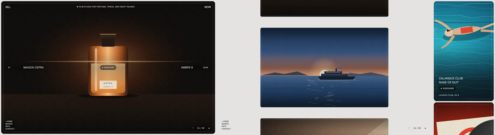

# Frame Reel Transitions

A video or film studio's best argument is one picture at a time, full screen. The weak versions crossfade between slides or slide them sideways, and every project feels like the next banner in a carousel. The frame reel makes the move itself the idea: the frame pulls back until you see the whole reel lying on a table, slides to the next card and dives back in. The visitor learns, in one second, that the site is a sequence of films and where they are in it.

Reference pattern: high-end production and post-production studios (Paris, London, Los Angeles) whose home page is a single framed project with tiny uppercase labels at the edges and a zoom-out move between projects.

Use this skill when the brief says: "showreel", "one project at a time", "cinematic", "film", "production company", "photographer", or the client has fewer than ten strong projects with one hero image or loop each. Do not use it for a long portfolio (use a list or strip index), for content people need to compare, or for a site whose visitors mostly arrive on phones looking for information (the phone version is a plain stack, which is fine, but the move is a desktop idea).

---

## 1. The Rules That Make It Look Expensive

1. **The frame never moves; the picture does.** An 8px inset, an 18px radius and a hairline inside at 14px. During a move the labels fade, the stack moves, the labels return. Nothing on the frame slides.
2. **Labels are tiny and on the edges.** 12px uppercase, 500, tracking 0.07em: wordmark split "Sel." top left and "Noir" top right, descriptor top center, menu bottom left, counter bottom right, number and year at the vertical middle of each side.
3. **The project line is the only larger text.** Client left of center, title right of center, both 18px uppercase regular, Discover between them. No headline, no paragraph on the home page.
4. **Zoom out, pan, zoom in.** Scale 1 to 0.3 around the viewport center (32 percent of the time), pan to the target card (to 68 percent), scale back to 1. One `cubic-bezier(.65, 0, .35, 1)` for all of it. 1.3 seconds for a neighbor, 140ms more per extra card, never more than 2 seconds.
5. **The canvas is part of the design.** Zoomed out, the stack lies on a warm light gray (#E4E3E0); cards are spaced 112 percent of the viewport apart, so at 0.3 the gaps read as the table between prints.
6. **Labels leave before the move and land after it.** Out in 0.2 seconds, back in 0.35 seconds after a 0.1 to 0.15 second delay. A label never travels with the picture.
7. **Every label reads on every still.** Each label carries its own soft radial scrim; the one control on the picture (Discover) gets a dark blurred pill. Then grade the stills: the label zones (edges and the middle row) must measure at least 4.5:1 against white. Measure it, do not eyeball it.
8. **One gesture, one step.** A trackpad flick sends a long tail of wheel events; only the first one of a gesture moves the reel. Keys and buttons queue, and the queue keeps only the final target.
9. **Works is the same stack zoomed out.** No separate grid page: the menu's "Works" pulls back to 0.3 and every card becomes a button.
10. **The case page grows out of the still.** Discover morphs the card's picture into the case hero with a View Transition; back returns into the same card, with focus on the Discover link that opened it.

---

## 2. Layout Blueprint (1440 x 900)

```
canvas #E4E3E0
┌─(8px inset, 18px radius)─────────────────────────────────────────────────────────────────┐
│ ┌─(hairline at 14px)──────────────────────────────────────────────────────────────────┐ │
│ │ SEL.                 ✺ FILM STUDIO FOR PERFUME, TRAVEL AND CRAFT HOUSES        NOIR │ │
│ │                                                                                     │ │
│ │ 01     MAISON OSTRA              (• DISCOVER)              AMBRE 9            2026 │ │ ← middle row
│ │                                                                                     │ │
│ │ • HOME                                                                              │ │
│ │ WORKS                                                                               │ │
│ │ INFO                                                                   ↑ 01 / 05 ↓ │ │
│ │ CONTACT                                                                             │ │
│ └─────────────────────────────────────────────────────────────────────────────────────┘ │
└───────────────────────────────────────────────────────────────────────────────────────────┘
next →  scale .3, pan 1.12 viewport heights, scale 1        Works →  scale .3 and stay
```

Phones (< 760px) and no JS: a plain header on the canvas (wordmark, descriptor, menu), then the cards as a scrolling column (74svh each, 8px apart), client and title stacked at the bottom of each frame over a gradient, Discover as a pill, the format line under it. Case pages are `:target` views and work the same everywhere.

---

## 3. Stack

- Web Animations API for the move (`element.animate` with four transform keyframes), the View Transitions API for the case morph, `inert` for the cards that are off screen, `:target` for case pages.
- About 170 lines of JS, no library. Every state is in the URL hash (`#p3`, `#info`, `#case-2`), so reloads and the back button land where they should.
- One neutral grotesk (Geist here; ABC Diatype, Neue Haas Unica or Inter Tight work) in two weights.
- The stills are inline SVG in the demo; for real work use `<video muted playsinline loop preload="none" poster>` on the current card only (see Performance).

---

## 4. The Markup

```html
<header class="chrome"> … wordmark, descriptor, menu, counter … </header>
<main class="reel" id="reel" aria-label="Works">
  <div class="stack">
    <section class="card" id="p1" style="--k:0" aria-label="01, Maison Ostra, Ambre 9, 2026">
      <div class="frame">
        <svg class="still" role="img" aria-label="…">…</svg>  <!-- or <video> /  -->
        <div class="meta">
          <span class="meta__no label">01</span>
          <h2 class="meta__client">Maison Ostra</h2>
          <a class="meta__open label" href="#case-1" data-open="1">Discover<span class="sr"> Ambre 9</span></a>
          <p class="meta__title">Ambre 9</p>
          <span class="meta__year label">2026</span>
        </div>
        <p class="meta__kind label">Perfume film, 45 s</p>
      </div>
    </section>
    <!-- more cards, --k:1, --k:2 …; the last one is Info -->
  </div>
</main>
<article class="case" id="case-1" tabindex="-1"> … back link with data-back="1", hero, brief, credits … </article>
<p class="sr" aria-live="polite" data-live></p>
```

---

## 5. The System (complete CSS from the demo)

```css
:root {
  --canvas: #E4E3E0;        /* the table the reel lies on when it zooms out */
  --ink: #161616;           /* 14.9:1 on --canvas */
  --ink-2: #55534F;         /* 6.1:1 on --canvas */
  --night: #0E0E0F;         /* info card and case pages */
  --light: #F4F2EE;
  --light-2: #A9A6A0;       /* 7.9:1 on --night */
  --sans: Geist, 'Helvetica Neue', Arial, sans-serif;
  --inset: 8px;             /* frame inset from the viewport edge */
  --radius: 18px;           /* frame corner radius */
  --hair: 14px;             /* inner hairline inset */
  --pitch: 112;             /* card pitch in the reel, % of the viewport height */
  --zoom: .3;               /* scale of the zoomed-out reel */
  --grain: url("data:image/png;base64,…")  /* a 96 px tiling noise PNG, alpha about 9 percent */;
}
@media (prefers-color-scheme: dark) {
  :root:not([data-theme="light"]) { --canvas: #1A1A1B; --ink: #EDEBE7; --ink-2: #A9A6A0; }
}
:root[data-theme="dark"] { --canvas: #1A1A1B; --ink: #EDEBE7; --ink-2: #A9A6A0; }

*, *::before, *::after { box-sizing: border-box; }
html, body { background: var(--canvas); color: var(--ink); }
body { margin: 0; font: 400 15px/1.45 var(--sans); -webkit-font-smoothing: antialiased; }
a { color: inherit; text-decoration: none; }
button { font: inherit; color: inherit; }
:focus-visible { outline: 2px solid currentColor; outline-offset: 3px; }
.sr { position: absolute; top: 0; left: 0; margin: 0; width: 1px; height: 1px; overflow: hidden; clip-path: inset(50%); white-space: nowrap; }
.skip { position: fixed; left: 16px; top: -60px; z-index: 90; padding: 8px 12px; background: var(--ink); color: var(--canvas); }
.skip:focus { top: 16px; }
.label { font-size: 12px; font-weight: 500; letter-spacing: .07em; text-transform: uppercase; line-height: 1.2; }

/* ---------- Chrome. Without JS (and on phones) it is a plain header on the canvas. ---------- */
.chrome { display: grid; grid-template-columns: 1fr auto 1fr; align-items: center; gap: 12px 20px; padding: 18px 16px 14px; }
.chrome__mark { font-size: 18px; font-weight: 500; letter-spacing: -.01em; text-transform: uppercase; }
.chrome__mark--r { justify-self: end; }
.chrome__desc { margin: 0; text-align: center; }
.chrome__nav { grid-column: 1 / -1; display: flex; gap: 18px; }
.chrome__nav a:hover { text-decoration: underline; text-underline-offset: 3px; }
.chrome__step { display: none; }

/* ---------- The stack: a column of framed cards ---------- */
.stack { display: grid; gap: var(--inset); padding: 0 var(--inset) var(--inset); }
.card { position: relative; height: calc(100svh - 2 * var(--inset)); min-height: 460px; scroll-margin-top: var(--inset); }
.frame { position: absolute; inset: 0; overflow: hidden; border-radius: var(--radius); background: #000; color: #fff; isolation: isolate; }
.still { position: absolute; inset: 0; width: 100%; height: 100%; display: block; z-index: -2; }
/* Scrims where the labels sit (edges and the middle band), grain over everything, a hairline inside the frame */
.frame::before {
  content: ""; position: absolute; inset: 0; z-index: -1; pointer-events: none;
  background:
    var(--grain),
    linear-gradient(transparent 38%, rgb(0 0 0 / var(--band, .22)) 50%, transparent 62%),
    linear-gradient(rgb(0 0 0 / .4), transparent 16%, transparent 84%, rgb(0 0 0 / .4));
}
.frame::after { content: ""; position: absolute; inset: var(--hair); border: 1px solid rgb(255 255 255 / .3); border-radius: calc(var(--radius) - var(--hair) / 2); pointer-events: none; }
.meta { position: absolute; left: 0; right: 0; top: 50%; translate: 0 -50%; display: grid; grid-template-columns: 1fr auto 1fr; align-items: center; gap: 12px; padding: 0 calc(var(--hair) + 18px); }
.meta__no, .meta__year { display: none; }
/* every label on the frame carries its own soft scrim instead of a hard band across the picture */
.meta > * { background: radial-gradient(closest-side, rgb(0 0 0 / .5), rgb(0 0 0 / 0)); padding: 10px 22px; }
.meta__client, .meta__title { margin: 0; font-size: 18px; font-weight: 400; letter-spacing: .01em; text-transform: uppercase; line-height: 1.2; }
.meta__title { justify-self: end; text-align: right; }
/* the one control on the picture gets a real backing: it sits on the brightest part of every still */
.meta .meta__open { display: inline-flex; align-items: center; gap: 8px; padding: 9px 14px; border-radius: 999px; background: rgb(12 12 12 / .55); -webkit-backdrop-filter: blur(8px); backdrop-filter: blur(8px); transition: background .2s; }
.meta .meta__open:hover { background: rgb(12 12 12 / .8); }
.meta__open::before { content: ""; width: 6px; height: 6px; border-radius: 50%; background: currentColor; }
.meta__kind { position: absolute; left: calc(var(--hair) + 18px); bottom: calc(var(--hair) + 16px); margin: 0; opacity: .85; }

/* The info card: text on night, kept clear of the corners where the chrome sits */
.card--info .frame { background: var(--night); }
.info { position: absolute; inset: 0; display: grid; align-content: center; gap: 36px; padding: 70px calc(var(--hair) + 22px); }
.info__lead { margin: 0; max-width: 23em; font-size: clamp(24px, 2.6vw, 40px); line-height: 1.12; letter-spacing: -.02em; }
.info__lead span { color: var(--light-2); }
.info__cols { display: grid; grid-template-columns: repeat(3, minmax(0, 1fr)); gap: 20px; max-width: 900px; color: var(--light-2); }
.info__cols p { margin: 0; }
.info__cols .label { color: var(--light); display: block; margin-bottom: 8px; }
.info a:hover { color: var(--light); text-decoration: underline; text-underline-offset: 3px; }

/* ---------- Case pages: a :target view, so they work without JS ---------- */
.case { display: none; }
.case:target { display: block; position: fixed; inset: 0; z-index: 60; overflow: auto; overscroll-behavior: contain; background: var(--night); color: var(--light); }
body:has(.case:target) { overflow: hidden; }
.case__bar { position: sticky; top: 0; z-index: 2; display: grid; grid-template-columns: 1fr auto 1fr; gap: 16px; align-items: center; padding: 14px 18px; background: var(--night); }
.case__bar > :nth-child(2) { text-align: center; }
.case__bar > :last-child { justify-self: end; }
.case__bar a:hover { text-decoration: underline; text-underline-offset: 3px; }
.case__hero { position: relative; height: 78svh; min-height: 380px; margin: 0 var(--inset); overflow: hidden; border-radius: var(--radius); }
.case__hero .still { z-index: 0; }
.case__body { display: grid; grid-template-columns: repeat(4, minmax(0, 1fr)); gap: 28px 20px; padding: 44px 18px 30px; }
.case__body h2 { grid-column: 1 / 3; margin: 0; font-size: 18px; font-weight: 400; text-transform: uppercase; letter-spacing: .01em; }
.case__brief { grid-column: 1 / 4; margin: 0; max-width: 26em; font-size: clamp(22px, 2.2vw, 32px); line-height: 1.15; letter-spacing: -.015em; }
.case__credits { grid-column: 4; margin: 0; display: grid; grid-template-columns: auto 1fr; gap: 6px 16px; color: var(--light-2); align-self: start; }
.case__credits dt { color: var(--light); }
.case__credits dd { margin: 0; }
.case__crops { display: grid; grid-template-columns: 1fr 1fr; gap: var(--inset); padding: 0 var(--inset) var(--inset); }
.case__crops figure { margin: 0; position: relative; aspect-ratio: 16 / 10; overflow: hidden; border-radius: var(--radius); }
.case__crops svg { width: 100%; height: 100%; display: block; }
.case__next { display: block; padding: 40px 18px 56px; font-size: clamp(22px, 2.2vw, 32px); letter-spacing: -.015em; }
.case__next span { color: var(--light-2); }
.case__next:hover span { color: var(--light); }

/* ---------- Reel mode (desktop with JS): one framed card fills the screen, the chrome sits on the frame ---------- */
.reel-on body { overflow: hidden; height: 100svh; }
.reel-on .chrome { position: fixed; inset: var(--inset); z-index: 20; display: block; padding: 0; color: #fff; pointer-events: none; transition: opacity .3s; }
.reel-on .chrome a, .reel-on .chrome button { pointer-events: auto; }
.reel-on .chrome > * { position: absolute; }
/* each label carries its own soft scrim, so it reads on the lightest still (principle 2) */
.reel-on .chrome > * { background: radial-gradient(closest-side, rgb(0 0 0 / .45), rgb(0 0 0 / 0)); padding: 8px 16px; margin: -8px -16px; }
.reel-on.is-overview .chrome > *, .reel-on.is-moving .chrome > * { background: none; }
.reel-on .chrome__mark--l { left: calc(var(--hair) + 14px); top: calc(var(--hair) + 12px); }
.reel-on .chrome__mark--r { right: calc(var(--hair) + 14px); top: calc(var(--hair) + 12px); }
.reel-on .chrome__desc { left: 50%; top: calc(var(--hair) + 16px); translate: -50% 0; white-space: nowrap; }
.reel-on .chrome__nav { left: calc(var(--hair) + 14px); bottom: calc(var(--hair) + 12px); display: grid; gap: 2px; }
.reel-on .chrome__nav a[aria-current="true"]::before { content: "• "; }
.reel-on .chrome__step { right: calc(var(--hair) + 10px); bottom: calc(var(--hair) + 8px); display: flex; align-items: center; gap: 6px; }
.chrome__step button { appearance: none; border: 0; background: none; width: 32px; height: 32px; display: grid; place-items: center; cursor: pointer; border-radius: 50%; }
.chrome__step button:hover { background: rgb(255 255 255 / .14); }
.chrome__step button:disabled { opacity: .35; cursor: default; background: none; }
.chrome__step svg { width: 14px; height: 14px; }
.chrome__step span { min-width: 64px; text-align: center; font-variant-numeric: tabular-nums; }

.reel-on .reel { position: fixed; inset: 0; overflow: clip; }
.reel-on .stack { display: block; position: absolute; left: 0; top: 0; width: 100vw; height: 100svh; padding: 0; transform-origin: 0 0; will-change: transform; }
.reel-on .card { position: absolute; left: var(--inset); right: var(--inset); top: calc(var(--k) * var(--pitch) * 1svh + var(--inset)); height: calc(100svh - 2 * var(--inset)); min-height: 0; }
.reel-on .meta { grid-template-columns: 40px minmax(0, 1fr) auto minmax(0, 1fr) 40px; padding: 0 calc(var(--hair) + 10px); }
.reel-on .meta__no, .reel-on .meta__year { display: block; }
.reel-on .meta__year { justify-self: end; }
.reel-on .meta__client { justify-self: start; padding-left: 5vw; }
.reel-on .meta__title { padding-right: 5vw; }
.reel-on .meta__kind { display: none; }
.reel-on .info { padding: 90px 25% 90px calc(var(--hair) + 14px); }
/* labels leave before the frame moves and return after it lands */
.meta, .info { transition: opacity .35s .1s; }
.reel-on.is-moving .meta, .reel-on.is-moving .info, .reel-on.is-overview .meta, .reel-on.is-overview .info { opacity: 0; transition-duration: .2s; transition-delay: 0s; }
.reel-on.is-moving .chrome__mark, .reel-on.is-moving .chrome__desc, .reel-on.is-overview .chrome__mark, .reel-on.is-overview .chrome__desc { opacity: 0; transition: opacity .2s; }
.chrome__mark, .chrome__desc { transition: opacity .35s .15s; }
/* zoomed out, the canvas shows: the chrome turns to ink and every card is a button */
.reel-on.is-overview .chrome, .reel-on.is-moving .chrome { color: var(--ink); }
.reel-on.is-overview .chrome__step { visibility: hidden; }
.reel-on.is-overview .card { cursor: zoom-in; }
.reel-on.is-overview .card:hover .frame, .reel-on.is-overview .card:focus-visible .frame { outline: 6px solid var(--ink); outline-offset: 10px; }
.reel-on.is-overview .card:focus-visible { outline: none; }

/* ---------- Phones ---------- */
@media (max-width: 760px) {
  .chrome { grid-template-columns: 1fr 1fr; }
  .chrome__desc { grid-column: 1 / -1; grid-row: 2; text-align: left; }
  .card { height: 74svh; min-height: 420px; }
  .meta { grid-template-columns: 1fr; justify-items: start; gap: 4px; top: auto; bottom: calc(var(--hair) + 50px); translate: none; }
  .meta__title { justify-self: start; text-align: left; }
  .meta > * { background: none; padding: 0; }
  .meta .meta__open { padding: 8px 14px 8px 12px; }
  .meta__open { order: 3; margin-top: 8px; }
  .frame::before { background: var(--grain), linear-gradient(transparent 45%, rgb(0 0 0 / .62) 82%, rgb(0 0 0 / .7)); }
  .card--info { height: auto; min-height: 0; }
  .card--info .frame { position: relative; }
  .info { position: relative; padding: 42px calc(var(--hair) + 14px); }
  .info__cols { grid-template-columns: 1fr; }
  .case__body { grid-template-columns: 1fr; }
  .case__body h2, .case__brief, .case__credits { grid-column: 1; }
  .case__bar { grid-template-columns: 1fr auto; }
  .case__bar > :nth-child(2) { display: none; }
  .case__crops { grid-template-columns: 1fr; }
}

@media (prefers-reduced-motion: reduce) {
  .meta, .info, .chrome, .chrome__mark, .chrome__desc { transition: none !important; }
  ::view-transition-group(*), ::view-transition-old(*), ::view-transition-new(*) { animation: none !important; }
}
::view-transition-group(still) { animation-duration: .7s; animation-timing-function: cubic-bezier(.65, 0, .35, 1); }
```

---

## 6. Behavior (complete JS from the demo)

```js
// Reel: on wide screens with JS, the stack becomes one framed card at a time. Moving to another card
// zooms the whole stack out, pans, and zooms back in; the frame's labels leave first and land last.
(function () {
  var root = document.documentElement, body = document.body;
  var wide = matchMedia('(min-width: 761px)'), still = matchMedia('(prefers-reduced-motion: reduce)');
  var stack = document.querySelector('.stack'), cards = [].slice.call(document.querySelectorAll('.card'));
  var stepEl = document.querySelector('[data-step]'), live = document.querySelector('[data-live]');
  var prev = document.querySelector('[data-prev]'), next = document.querySelector('[data-next]');
  var navLinks = [].slice.call(document.querySelectorAll('.chrome__nav a'));
  var n = cards.length, works = n - 1;           // the last card is Info
  var i = 0, target = 0, anim = null, pending = null, overview = false, on = false;
  var ZOOM = parseFloat(getComputedStyle(root).getPropertyValue('--zoom')) || .3;
  var PITCH = (parseFloat(getComputedStyle(root).getPropertyValue('--pitch')) || 112) / 100;

  function pad(k) { return (k < 9 ? '0' : '') + (k + 1); }
  // Place the stack so card `pos` is centred, at scale `s`, scaling around the viewport centre.
  function xf(s, pos) {
    var cx = innerWidth / 2, cy = innerHeight / 2, y = pos * PITCH * innerHeight + cy;
    return 'translate(' + cx + 'px,' + cy + 'px) scale(' + s + ') translate(' + -cx + 'px,' + -y + 'px)';
  }
  function settle() {
    stack.style.transform = xf(overview ? ZOOM : 1, i);
    cards.forEach(function (c, k) { c.inert = !overview && k !== i; if (overview) c.tabIndex = 0; else c.removeAttribute('tabindex'); });
    stepEl.textContent = i === works ? 'Info' : pad(i) + ' / ' + pad(works - 1);
    prev.disabled = i === 0; next.disabled = i === n - 1;
    navLinks.forEach(function (a) {
      var which = overview ? 'works' : i === works ? 'info' : 'home';
      a.setAttribute('aria-current', String(a.dataset.nav === which));
    });
    var hash = i === works ? '#info' : '#p' + (i + 1);
    if (location.hash !== hash && !/^#case-/.test(location.hash)) history.replaceState(null, '', hash);
  }
  function announce() {
    var c = cards[i];
    live.textContent = overview ? 'All works, ' + works + ' projects' : c.getAttribute('aria-label');
  }
  function go(j) {
    if (!on) return;                             // phones and no-JS keep the plain scrolling stack
    j = Math.max(0, Math.min(n - 1, j));
    if (anim) { pending = j; return; }           // no backlog: only the latest target survives
    var from = i, wasOver = overview;
    if (j === from && !wasOver) return;
    overview = false;
    if (still.matches) { i = j; settle(); announce(); return; }
    var frames = wasOver
      ? [{ transform: xf(ZOOM, from) }, { transform: xf(ZOOM, j), offset: .45 }, { transform: xf(1, j) }]
      : [{ transform: xf(1, from) }, { transform: xf(ZOOM, from), offset: .32 }, { transform: xf(ZOOM, j), offset: .68 }, { transform: xf(1, j) }];
    var dur = Math.min(2000, (wasOver ? 1000 : 1300) + 140 * Math.max(0, Math.abs(j - from) - 1));
    target = j;
    root.classList.add('is-moving'); root.classList.remove('is-overview');
    cards.forEach(function (c) { c.inert = true; });
    anim = stack.animate(frames, { duration: dur, easing: 'cubic-bezier(.65,0,.35,1)', fill: 'forwards' });
    anim.finished.then(function () {
      i = j; anim.cancel(); anim = null; settle();
      root.classList.remove('is-moving'); announce();
      if (pending !== null && pending !== i) { var p = pending; pending = null; go(p); } else pending = null;
    });
  }
  function step(d) { go((pending !== null ? pending : anim ? target : i) + d); }   // presses during a move add up
  function showAll() {
    if (!on || anim || overview) return;
    overview = true;
    root.classList.add('is-overview');
    if (!still.matches) {
      anim = stack.animate([{ transform: xf(1, i) }, { transform: xf(ZOOM, i) }], { duration: 650, easing: 'cubic-bezier(.65,0,.35,1)', fill: 'forwards' });
      anim.finished.then(function () { anim.cancel(); anim = null; settle(); announce(); cards[i].focus({ preventScroll: true }); });
    } else { settle(); announce(); cards[i].focus({ preventScroll: true }); }
  }

  function enable() {
    on = true; root.classList.add('reel-on');
    var m = /^#p(\d+)$/.exec(location.hash), c = /^#case-(\d+)$/.exec(location.hash);
    i = m ? Math.min(+m[1] - 1, n - 1) : c ? +c[1] - 1 : location.hash === '#info' ? works : 0;
    settle();
  }
  function disable() {
    on = false; overview = false; if (anim) { anim.cancel(); anim = null; }
    root.classList.remove('reel-on', 'is-moving', 'is-overview');
    stack.style.transform = ''; cards.forEach(function (c) { c.inert = false; });
  }
  function sync() { if (wide.matches && !on) enable(); else if (!wide.matches && on) disable(); }
  wide.addEventListener('change', sync); sync();
  addEventListener('resize', function () { if (on && !anim) settle(); });

  // Input: one wheel gesture is one step (trackpad momentum is ignored until it goes quiet)
  var lastWheel = 0, armed = true;
  addEventListener('wheel', function (e) {
    if (!on || /^#case-/.test(location.hash)) return;
    var now = performance.now();
    if (now - lastWheel > 220) armed = true;
    lastWheel = now;
    if (!armed || Math.abs(e.deltaY) < 6) return;
    armed = false;
    if (overview) { panTo(i + (e.deltaY > 0 ? 1 : -1)); return; }
    step(e.deltaY > 0 ? 1 : -1);
  }, { passive: true });
  function panTo(j) {
    j = Math.max(0, Math.min(n - 1, j));
    if (anim || j === i) return;
    if (still.matches) { i = j; settle(); return; }
    anim = stack.animate([{ transform: xf(ZOOM, i) }, { transform: xf(ZOOM, j) }], { duration: 500, easing: 'cubic-bezier(.65,0,.35,1)', fill: 'forwards' });
    anim.finished.then(function () { i = j; anim.cancel(); anim = null; settle(); });
  }
  addEventListener('keydown', function (e) {
    if (!on || /^#case-/.test(location.hash) || e.altKey || e.ctrlKey || e.metaKey) return;
    var k = e.key, t = e.target;
    if (t.closest && t.closest('input, textarea, select')) return;
    if (k === 'ArrowDown' || k === 'PageDown' || (k === ' ' && t === body)) { e.preventDefault(); overview ? panTo(i + 1) : step(1); }
    else if (k === 'ArrowUp' || k === 'PageUp') { e.preventDefault(); overview ? panTo(i - 1) : step(-1); }
    else if (k === 'Home') { e.preventDefault(); go(0); }
    else if (k === 'End') { e.preventDefault(); go(n - 1); }
    else if (k === 'Escape' && overview) { go(i); }
    else if (k === 'Enter' && overview) { e.preventDefault(); go(t.classList && t.classList.contains('card') ? cards.indexOf(t) : i); }
  });
  var touchY = null;
  addEventListener('touchstart', function (e) { touchY = e.touches[0].clientY; }, { passive: true });
  addEventListener('touchend', function (e) {
    if (!on || touchY === null) return;
    var dy = touchY - e.changedTouches[0].clientY; touchY = null;
    if (Math.abs(dy) > 48) step(dy > 0 ? 1 : -1);
  }, { passive: true });
  prev.addEventListener('click', function () { step(-1); });
  next.addEventListener('click', function () { step(1); });
  document.addEventListener('click', function (e) {
    if (!on) return;
    var a = e.target.closest('[data-go], [data-works]');
    if (a) { e.preventDefault(); a.hasAttribute('data-works') ? showAll() : go(+a.getAttribute('data-go')); return; }
    var card = overview && e.target.closest('.card');
    if (card) { e.preventDefault(); go(cards.indexOf(card)); }
  });
  window.reel = { go: go, showAll: showAll, get index() { return i; } };   // used by the case pages below
})();

// Case pages: "Discover" morphs the card's still into the case hero with a View Transition.
// The URL hash is the state (#case-2), so the pages work without JS and survive a reload.
(function () {
  var still = matchMedia('(prefers-reduced-motion: reduce)');
  function swap(update, from, to, after) {
    after = after || function () {};
    if (!document.startViewTransition || still.matches || !from || !to) { update(); after(); return; }
    from.style.viewTransitionName = 'still';
    var t = document.startViewTransition(function () { from.style.viewTransitionName = ''; update(); to.style.viewTransitionName = 'still'; });
    t.finished.finally(function () { to.style.viewTransitionName = ''; after(); });
  }
  function cardStill(k) { var c = document.getElementById('p' + k); return c && c.querySelector('.still'); }
  function heroStill(k) { var c = document.getElementById('case-' + k); return c && c.querySelector('.case__hero .still'); }
  document.addEventListener('click', function (e) {
    var open = e.target.closest('[data-open]');
    if (open) {
      e.preventDefault();
      var k = +open.getAttribute('data-open');
      swap(function () { location.hash = 'case-' + k; }, cardStill(k), heroStill(k));
      return;
    }
    var back = e.target.closest('[data-back]');
    if (back) {
      e.preventDefault();
      var b = +back.getAttribute('data-back');
      var opener = document.querySelector('[data-open="' + b + '"]');
      // focus returns to the Discover link that opened the case, once the card is live again
      swap(function () { location.hash = 'p' + b; if (window.reel) window.reel.go(b - 1); }, heroStill(b), cardStill(b),
        function () { if (opener) opener.focus({ preventScroll: true }); });
    }
  });
  addEventListener('keydown', function (e) {
    var m = /^#case-(\d+)$/.exec(location.hash);
    if (m && e.key === 'Escape') { var b = document.querySelector('#case-' + m[1] + ' [data-back]'); if (b) b.click(); }
  });
  addEventListener('hashchange', function () {
    var m = /^#case-(\d+)$/.exec(location.hash);
    if (m) { var c = document.getElementById('case-' + m[1]); c.scrollTop = 0; c.querySelector('[data-back]').focus({ preventScroll: true }); }
  });
})();
```

---

## 7. Why Each Part Is Built This Way

- **One transform on the stack, not one per card.** `translate(cx, cy) scale(s) translate(-cx, -(pos × pitch + cy))` with `transform-origin: 0 0` centers card `pos` at scale `s`. Interpolating that single matrix between four keyframes gives the zoom, the pan and the dive with no layout work, on the compositor.
- **Pitch 112 percent.** At scale 1 the neighbors are fully off screen; at 0.3 they sit 0.36 viewport heights apart with a clear gap of canvas. At 100 percent the cards would touch when zoomed out.
- **WAAPI with `fill: 'forwards'`, then cancel and write the final transform.** Leaving finished animations filled stacks them up and leaks memory; cancelling after writing the inline style hands the state back to plain CSS.
- **`pending` keeps one target.** Each press during a move counts from the move's target, so four fast presses go four cards, and the next move starts from where the last one landed. No backlog of queued animations.
- **Wheel gestures by silence.** A new gesture starts after 220ms without wheel events. Trackpad momentum keeps firing well under that, so it never triggers a second step.
- **`inert` on off-screen cards.** Tab would otherwise walk through every hidden Discover link and scroll the clipped reel. Zoomed out, all cards become focusable buttons instead.
- **`overflow: clip` on the reel.** A fragment link (`#p3`) or `focus()` cannot scroll a clip container, so the hash can carry state without the browser jumping the stack.
- **The reel only runs where it is on.** `go()` returns when reel mode is off. Without that guard, closing a case page on a phone ran a desktop move on the scrolling stack and left a blank canvas.
- **Case pages are `:target` views.** They work without JS, with the back button, and after a reload. JS only adds the morph: name the card's still `still`, start the transition, move the name to the case hero inside the update callback (two elements must never share a name at the same moment).
- **Label scrims, not a band.** A dark stripe across the middle row read as a defect on the light ceramic still. Small radial scrims under each label, plus a pill under Discover, keep the picture clean.

---

## 8. Fallbacks and Accessibility

- **No JS or a phone:** a plain column of framed cards with scroll snapping off (the reader scrolls freely), the header on the canvas, and case pages via `:target`. Every project, link and case is reachable.
- **Reduced motion:** moves become instant swaps (no zoom), labels do not fade, the case morph is off. The same keys and buttons work.
- **Keyboard:** Up and Down (and Page Up and Down, Space on the page) step the reel; Home and End jump; the arrow buttons have names; Escape leaves the overview and closes a case; focus returns to the Discover link that opened the case. A live region announces "02, Navette Frioul, Ligne Bleue, 2025" after each move.
- **Contrast:** measured on screenshots of every card, against the brightest 10 percent of the pixels around each label: at least 4.65:1 for every frame label on every still. Ink on canvas 14.9:1, gray on night 7.9:1.
- **Semantics:** the reel is a `main` landmark, each card is a labelled `section`, the client is the `h2`, the year and number are plain text, the stills are described images.

---

## 9. Performance Checklist

- [ ] One composited transform per move; no layout or paint of the cards during it.
- [ ] Real video: only the current card plays (`play()` on landing, `pause()` before the move), others keep `preload="none"` and a poster. Never more than one decoder running.
- [ ] Stills as AVIF posters at 1600 to 2400 wide; `fetchpriority="high"` on the first one only.
- [ ] Grain is one 15 KB tiling PNG in a data URI, not an SVG filter (filters on full-screen layers repaint on every frame of the move).
- [ ] `backdrop-filter` only on the small Discover pill.
- [ ] One `resize` handler that rewrites the transform; no scroll listeners at all.

---

## 10. Anti-Patterns (Instant Slop)

- A crossfading slider with dots, or slides that push sideways.
- Labels that ride along with the picture during the move.
- A headline and a paragraph on the home frame.
- Discover as a big filled button, or an arrow cursor that follows the mouse with "View".
- A trackpad flick that skips four projects.
- A "Works" page that is a separate grid unrelated to the reel.
- White labels on a light still without a scrim, checked by eye.
- Hijacking scroll on phones.

---

## 11. Working Demo

[`demo/index.html`](demo/index.html) is a complete site for an invented Marseille film studio, Sel Noir: five projects (a perfume film, a ferry campaign, a potter's brand film, a night swim launch, a record sleeve shoot) with original SVG film stills, an Info card, the zoomed-out Works view, and five case pages with credits and detail crops.

Verified with `node scripts/verify-demo.mjs skills/frame-reel-skill/demo` (desktop, phones at 360/390/430, reduced motion, forced fallback, dark scheme, focus, host body, fixed chrome, low contrast), plus a scripted pass through every card, mid-move frames, four fast presses, the overview, a case page open and closed on desktop and on a phone, and a pixel contrast check of every frame label on every still.



Lessons learned while building it (already folded into the rules above):

- The screen-reader live region kept a paragraph margin and hung 15px below the page on phones (verify's dead-scroll check).
- White frame labels measured 2.9 to 3.3:1 on the light ceramic still. Each label now has its own scrim, and the ceramic and ferry stills were regraded until every label passed 4.5:1.
- A dark band across the middle row, the first fix for that, read as a stripe across the picture. Replaced by label scrims and the Discover pill.
- Discover sat on the brightest spot of three stills (the bottle, the sun, the record label). It got a backing pill, and the record and swimmer were moved off center.
- Four fast presses moved three cards: the queue counted from the card the move started on. It now counts from the move's target.
- Closing a case on a phone left a blank canvas: the desktop move ran on the phone's scrolling stack. `go()` now does nothing when reel mode is off, and focus returns to the opener once the morph has finished.
- In the overview the cards could be clicked but not reached with the keyboard. They become focusable with a visible ring, and Enter dives into the focused card.
- On phones the desktop label padding pushed client and title apart and the swimmer sat under the labels. Phone labels lost the padding and the swimmer moved to the top third.

---

## 12. Pre-Flight

1. During a move, does anything on the frame move with the picture?
2. Does one trackpad flick move exactly one card, and do four fast key presses move exactly four?
3. Does every label measure 4.5:1 or better on every still, by pixels?
4. Is there one transform on one element per move, and is only one video playing?
5. Do Works, Info and every case page work after a reload, with the back button and without JS?
6. With reduced motion, is every move instant and still announced?
